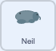

## Make Neil move

The starter project is open beside these instructions, with the sprites and `Town`{:class="block3looks"} backdrop ready.

## Step 1

Add `when green flag clicked`{:class="block3events"}, `go to x: () y: ()`{:class="block3motion"}, `point in direction ()`{:class="block3motion"}, and `show`{:class="block3looks"} to start **Neil** in the middle of the road, facing right.



```blocks3
when green flag clicked
go to x: (0) y: (-40)
point in direction (90)
show
```

## Step 2

Add another `when green flag clicked`{:class="block3events"} block with a `forever`{:class="block3control"} loop.

Inside it, use an `if then`{:class="block3control"} block to move **Neil** up when the `up arrow`{:class="block3sensing"} key is pressed.


```blocks3
when green flag clicked
forever
if <key (up arrow v) pressed?> then
change y by (5)
end
end
```

## Now run your code

Click the green flag and press the up arrow.

**Neil** moves up the screen.
