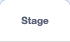
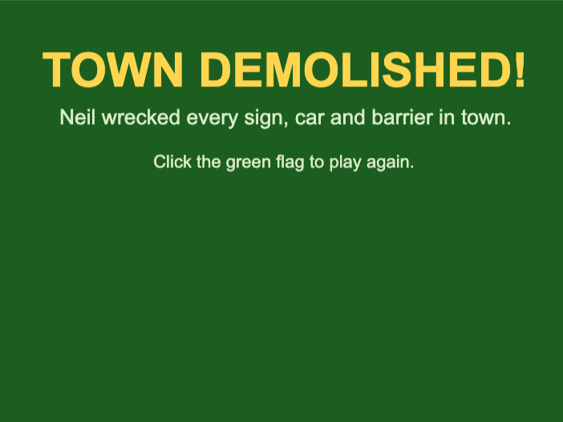

## Detect a win

## Step 1



Select the Stage's **Backdrops** tab. Hover over **Choose a Backdrop** and choose **Paint**.

Call the new backdrop `Win`{:class="block3looks"}, then add a background and some celebratory text.



## Step 2

Make a variable called `game over`{:class="block3variables"}, **For all sprites**, and untick its checkbox.

In the Stage's green flag script, add `switch backdrop to (Town)`{:class="block3looks"} and `set game over to (0)`{:class="block3variables"} as shown.


```blocks3
when green flag clicked
+switch backdrop to (Town v)
set [score v] to (0)
set [stuff to smash v] to (0)
+set [game over v] to (0)
```

## Step 3

Add a new script with `when green flag clicked`{:class="block3events"}, `wait (0.2) seconds`{:class="block3control"}, and a `forever`{:class="block3control"} loop. The wait lets the signs be counted first.

Inside the loop, check whether `stuff to smash`{:class="block3variables"} is less than `1`{:class="block3operators"} and `game over`{:class="block3variables"} equals `0`{:class="block3operators"}. If so, switch to `Win`{:class="block3looks"} and set `game over`{:class="block3variables"} to `1`{:class="block3variables"}.


```blocks3
when green flag clicked
wait (0.2) seconds
forever
if <<(stuff to smash) < (1)> and <(game over) = (0)>> then
switch backdrop to (Win v)
set [game over v] to (1)
end
end
```

## Now run your code

Click the green flag and smash all six signs. The `Win`{:class="block3looks"} backdrop appears. Click the green flag again to return to `Town`{:class="block3looks"}.
