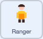

## Make the Ranger chase Neil

## Step 1

Make two variables, `neil x`{:class="block3variables"} and `neil y`{:class="block3variables"}, both **For all sprites**. Untick their checkboxes.

At the bottom of **Neil**'s movement code, inside `if game over = 0 then`{:class="block3control"}, set these variables to his `x position`{:class="block3motion"} and `y position`{:class="block3motion"}.


```blocks3
when green flag clicked
forever
if <(game over) = (0)> then
if <key (up arrow v) pressed?> then
change y by (5)
next costume
end
if <key (down arrow v) pressed?> then
change y by (-5)
next costume
end
if <key (left arrow v) pressed?> then
change x by (-5)
point in direction (-90)
next costume
end
if <key (right arrow v) pressed?> then
change x by (5)
point in direction (90)
next costume
end
+set [neil x v] to (x position)
+set [neil y v] to (y position)
end
end
```

## Step 2

Add a script to put **Ranger** in the corner at the start of each game.



```blocks3
when green flag clicked
go to x: (-200) y: (140)
show
```

## Step 3

Add another `when green flag clicked`{:class="block3events"} script with a `forever`{:class="block3control"} loop and an `if then`{:class="block3control"} block. Only chase while `game over`{:class="block3variables"} equals `0`{:class="block3operators"}.

Inside it, add two `if then else`{:class="block3control"} blocks. Compare **Neil**'s position with **Ranger**'s position to move right or left, then up or down.


```blocks3
when green flag clicked
forever
if <(game over) = (0)> then
if <(neil x) > (x position)> then
change x by (2)
else
change x by (-2)
end
if <(neil y) > (y position)> then
change y by (2)
else
change y by (-2)
end
end
end
```

## Now run your code

Click the green flag and move **Neil** around. **Ranger** follows him across the town.
