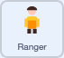

## Catch Neil

## Step 1

Make a variable called `lives`{:class="block3variables"}, **For all sprites**, and tick its checkbox.

Add `set lives to (3)`{:class="block3variables"} to the Stage's green flag script.


```blocks3
when green flag clicked
switch backdrop to (Town v)
set [score v] to (0)
set [stuff to smash v] to (0)
set [game over v] to (0)
+set [lives v] to (3)
```

## Step 2

In **Ranger**'s chase script, below the movement blocks and inside `if game over = 0 then`{:class="block3control"}, check `touching Neil`{:class="block3sensing"}. Add `change lives by (-1)`{:class="block3variables"} and `go to x: (-200) y: (140)`{:class="block3motion"}.



```blocks3
when green flag clicked
forever
if <(game over) = (0)> then
if <(neil x) > (x position)> then
change x by (2)
else
change x by (-2)
end
if <(neil y) > (y position)> then
change y by (2)
else
change y by (-2)
end
+if <touching (Neil v)?> then
change [lives v] by (-1)
go to x: (-200) y: (140)
end
end
end
```

## Step 3

Create a message called `got ya`{:class="block3events"}. Add `broadcast (got ya) and wait`{:class="block3events"} after **Ranger** returns to the corner.


```blocks3
if <touching (Neil v)?> then
change [lives v] by (-1)
go to x: (-200) y: (140)
+broadcast (got ya v) and wait
end
```

## Now run your code

Click the green flag and let **Ranger** catch **Neil**. The lives counter drops by `1`{:class="block3variables"} and **Ranger** returns to the corner.
