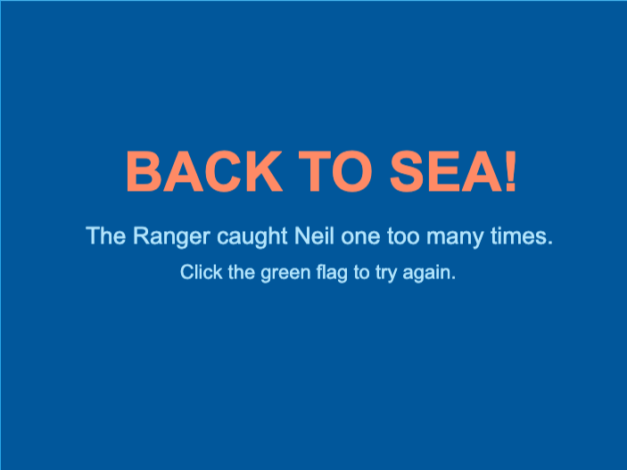

## End the game

## Step 1


Select the Stage's **Backdrops** tab. Hover over **Choose a Backdrop** and choose **Paint**.

Call the new backdrop `game over`{:class="block3looks"} and design a screen for when **Neil** runs out of lives.



## Step 2

Add a new script with `when green flag clicked`{:class="block3events"}, a `forever`{:class="block3control"} loop, and an `if then`{:class="block3control"} block.

Check whether `lives`{:class="block3variables"} is less than `1`{:class="block3operators"} and `game over`{:class="block3variables"} equals `0`{:class="block3operators"}. If so, switch to the `game over`{:class="block3looks"} backdrop and set `game over`{:class="block3variables"} to `1`{:class="block3variables"}.

Create a message also called `game over`{:class="block3events"} and broadcast it at the end of the `if then`{:class="block3control"} block.


```blocks3
when green flag clicked
forever
if <<(lives) < (1)> and <(game over) = (0)>> then
switch backdrop to (game over v)
set [game over v] to (1)
broadcast (game over v)
end
end
```

## Now run your code

Click the green flag and let **Ranger** catch **Neil** three times. The `game over`{:class="block3looks"} backdrop appears and both sprites stop moving. Restart to reset your lives.
