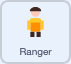

## The Ranger says goodbye

Add `when I receive (game over)`{:class="block3events"} and `say () for () seconds`{:class="block3looks"} to make **Ranger** say “Off you go!”.



```blocks3
when I receive (game over v)
say [Off you go!] for (1) seconds
```

## Now run your code

Click the green flag and lose all three lives. **Ranger** says “Off you go!” when the game ends.
