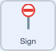

## Tidy up the signs

When the game ends, all the stop sign clones are still lying around town.

Get them to tidy themselves up.

In the clone's `forever`{:class="block3control"} loop, add an `if then`{:class="block3control"} block that checks whether `game over`{:class="block3variables"} equals `1`{:class="block3operators"}.

If it is, `delete this clone`{:class="block3control"}.



```blocks3
when I start as a clone
forever
if <<touching (Neil v)?> and <key (space v) pressed?>> then
change [score v] by (10)
change [stuff to smash v] by (-1)
delete this clone
end
+if <(game over) = (1)> then
delete this clone
end
end
```

## Now run your code

Click the green flag and let the **Ranger** catch **Neil** three times.

The `game over`{:class="block3looks"} backdrop appears, **Ranger** says “Off you go!”, and the leftover signs disappear.
