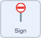
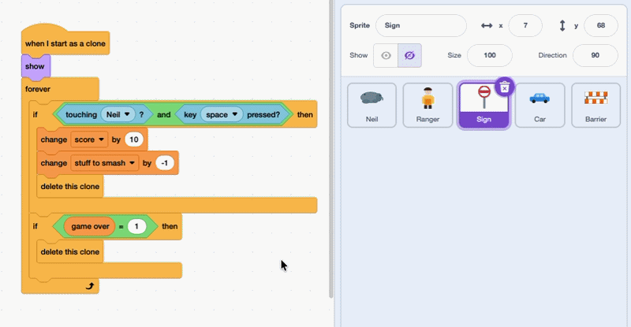

## Copy the code to cars and barriers

Add cars and barriers for **Neil** to smash too.

Copy the stop sign code to reuse it.

Drag each of **Sign**'s two scripts onto the **Car** sprite in the sprite list, then onto the **Barrier** sprite, to copy the code across.

The copied `create clone of (myself)`{:class="block3control"} and `touching Neil`{:class="block3sensing"} blocks work for both sprites.

--- no-print ---

--- /no-print ---

## Now run your code

Click the green flag.

The town now has cars and barriers to smash as well as signs.
