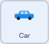
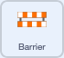

## Customise your cars and barriers

Make the cars and barriers your own.

You'll make these changes on both the **Car** and **Barrier** sprites.

## Step 1

In **Car**'s `repeat ()`{:class="block3control"} loop, change the number to decide how many cars appear.

Then do the same on the **Barrier** sprite.

## Step 2

On both **Car** and **Barrier**, decide how many points each one is worth by changing the number in the `change score by ()`{:class="block3variables"} block.

Maybe some things are trickier to reach and should be worth more?

## Step 3

Choose where each type of object appears.

In the `go to x: () y: ()`{:class="block3motion"} block, change the `pick random () to ()`{:class="block3operators"} numbers to set the area they spawn in — for example, keeping the cars low down so they stay on the road.

## Now run your code

Click the green flag.

The town is now full of signs, cars, and barriers to smash — each worth the points you chose, in the places you picked.
