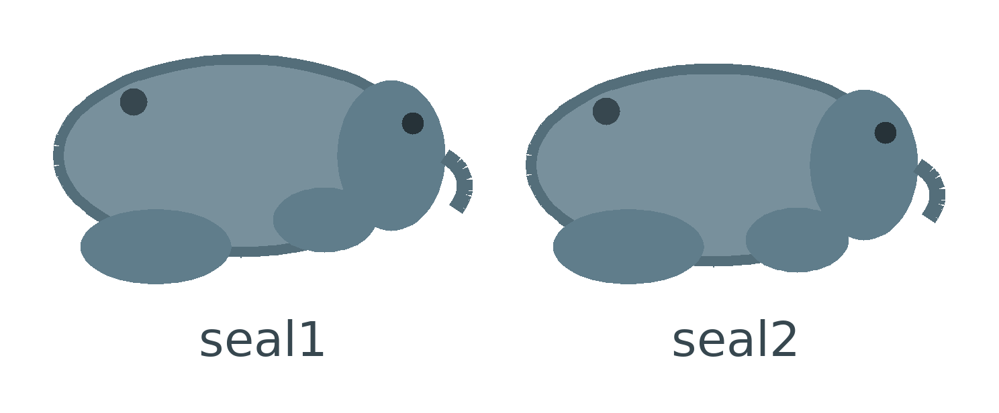

## Make Neil waddle

Give **Neil** a second costume so he looks like he's walking.

## Step 1


Open the **Costumes** tab.

**Neil** has one costume, called `seal1`{:class="block3looks"}.

Right-click `seal1`{:class="block3looks"} and choose **duplicate** to make `seal2`{:class="block3looks"}.

In the paint editor, move each of **Neil**'s legs a little, so `seal2`{:class="block3looks"} is in a different pose to `seal1`{:class="block3looks"}.



## Step 2

Go back to the **Code** tab.

Add a `next costume`{:class="block3looks"} block inside each of your four arrow-key `if then`{:class="block3control"} blocks, so **Neil** changes costume whenever he moves.


```blocks3
if <key (up arrow v) pressed?> then
change y by (5)
+next costume
end
```

## Now run your code

Click the green flag and move **Neil** around.

His two costumes swap back and forth, so he looks like he's waddling.
