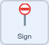

## Count and score the signs

## Step 1

Make two variables, `score`{:class="block3variables"} and `stuff to smash`{:class="block3variables"}, both **For all sprites**.

Tick `score`{:class="block3variables"} to show it, and untick `stuff to smash`{:class="block3variables"} to hide it.

Add a script to reset both to `0`{:class="block3variables"}.


```blocks3
when green flag clicked
set [score v] to (0)
set [stuff to smash v] to (0)
```

## Step 2

Add a `wait () seconds`{:class="block3control"} block set to `0.1`{:class="block3control"} below `when green flag clicked`{:class="block3events"}. Inside the `repeat ()`{:class="block3control"} loop, add `change stuff to smash by (1)`{:class="block3variables"} after creating each clone.



```blocks3
when green flag clicked
+wait (0.1) seconds
show
repeat (6)
go to x: (pick random (-220) to (220)) y: (pick random (-100) to (130))
create clone of (myself v)
+change [stuff to smash v] by (1)
end
hide
```

The short wait gives the Stage time to reset `stuff to smash`{:class="block3variables"} before the signs are counted.

## Step 3

In the clone script, add `change score by (10)`{:class="block3variables"} and `change stuff to smash by (-1)`{:class="block3variables"} before `delete this clone`{:class="block3control"}.


```blocks3
when I start as a clone
forever
if <<touching (Neil v)?> and <key (space v) pressed?>> then
+change [score v] by (10)
+change [stuff to smash v] by (-1)
delete this clone
end
end
```

## Now run your code

Click the green flag and smash some signs. Each sign adds `10`{:class="block3variables"} to your score. Restart the game and check that the score resets to `0`{:class="block3variables"}.
